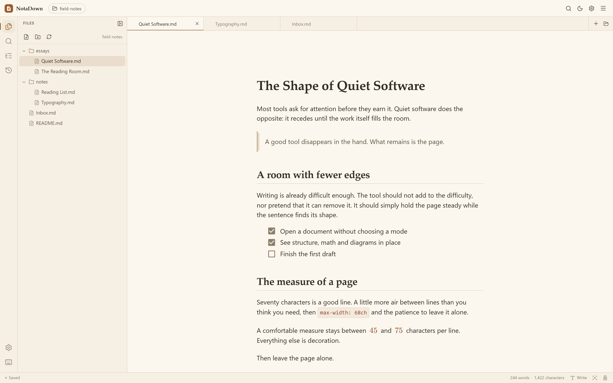

<p align="right">
  <a href="./README.md">English</a> · <strong>简体中文</strong>
</p>

<p align="center">
  
</p>

<h1 align="center">NotaDown</h1>

<p align="center"><em>一款离线优先、专注于无干扰写作的 Markdown 编辑器。</em></p>

<p align="center">
  
</p>

NotaDown 的书写与排版共用同一个界面。格式、公式、图表和图片在输入位置即时呈现，不需要源代码与预览分栏。所有内容都保存在本地磁盘。

## 功能

- 基于 Milkdown 的单界面所见即所得编辑，可通过块菜单创建副本、上下移动或删除，需要时也可切换为整篇源码模式。
- 文件夹工作区、多标签、拖拽移动、外部变更检测、全局搜索与文档大纲。
- 自动保存、手动保存、每个标签的保存状态，以及静默的本地版本历史。
- 代码高亮、表格、任务列表、KaTeX 数学公式、Mermaid 图表，以及经过清理的行内与块级 HTML。
- 图片可存放在文档旁边的资源目录、全局附件目录，或直接嵌入文档。
- 四套预设主题、浅色与深色模式、自定义 CSS、可精确输入的字号/行高、较窄/默认/较宽/全宽四档正文宽度等外观设置、专注模式与打字机模式。
- 导出为独立 HTML 或 PDF。
- 英文与简体中文界面。
- 同一套代码提供网页版与桌面版。
- 桌面端可在设置中选择系统标题栏或一体化标题栏。
- 桌面版支持双击 Markdown 文件打开，也可将文件拖入窗口。Windows 安装包可选择关联 `.md`、`.markdown`、`.mdown`、`.mkd` 中的哪些扩展名；Linux `.deb` 包会注册全部四种，macOS 在应用包中声明同样的类型。若这些扩展名已被其他编辑器占用，需在系统设置中将 NotaDown 设为默认应用。
- 桌面版可在启动时检查更新，发现新版本后在应用内提示并展示更新日志，在 Windows 与 Linux AppImage 上直接下载安装。启动检查可在设置中关闭，也可随时从帮助菜单手动检查。
- 网页版可安装为 PWA，并从缓存的应用外壳离线启动。

## 环境要求

- Node.js 22 或更高版本
- pnpm 12

## 开发

```bash
pnpm install

# 网页版
pnpm dev

# 桌面版（热更新）
pnpm dev:desktop
```

网页版与桌面版共用开发服务器 `http://127.0.0.1:5813`。

类型检查与测试：

```bash
pnpm typecheck
pnpm test
```

## 构建

```bash
# 网页版构建（apps/web/dist）
pnpm build

# 桌面渲染进程与未打包应用（apps/desktop/release）
pnpm build:desktop

# 桌面安装包
pnpm package:desktop
```

## 项目结构

| 包                   | 用途                             |
| ------------------- | ------------------------------ |
| `apps/web`          | Vue 3 应用外壳与编辑工作区               |
| `apps/desktop`      | Electron 主进程、预加载桥接与打包          |
| `packages/shared`   | 共享类型、设置、快捷键与工具函数               |
| `packages/editor`   | Milkdown 编辑器、命令、公式、Mermaid 与样式 |
| `packages/platform` | 网页与桌面平台的抽象层                    |
| `packages/exporter` | 独立 HTML 与 PDF 文档渲染             |
| `packages/i18n`     | 多语言定义与语言检测                     |

## 浏览器支持

文件夹工作区依赖 File System Access API，需要桌面端 Chromium 内核浏览器。其他浏览器仍可打开单个文件、在本地保存草稿，并通过打印对话框导出。桌面版没有这些限制。

## 数据与隐私

NotaDown 不需要账号，不收集遥测，也不使用远程存储。文档、设置与版本历史都留在本机：网页版存储在浏览器的 IndexedDB 中，桌面版存储在应用数据目录中。文档中引用的远程图片会从原始地址加载。

## 许可证

[MIT](./LICENSE)
